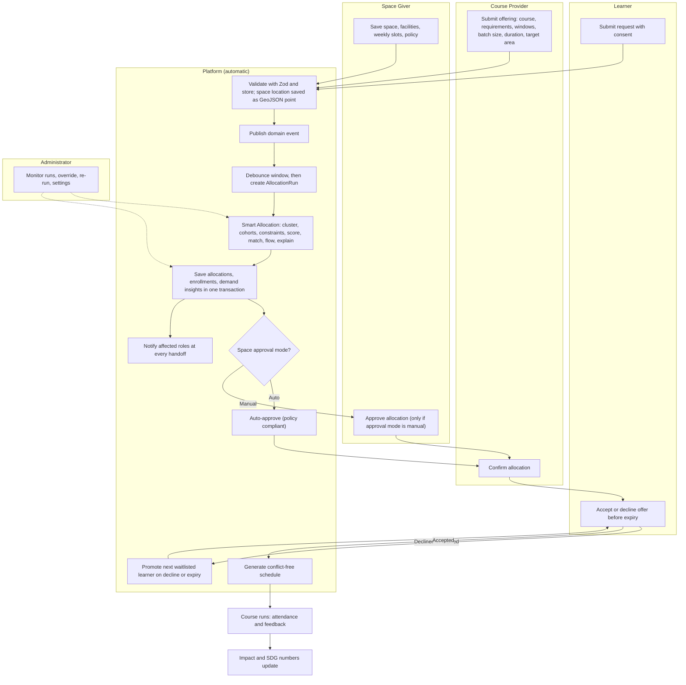
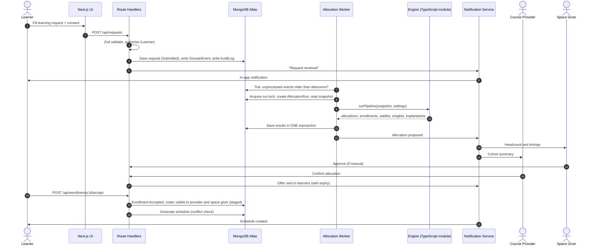
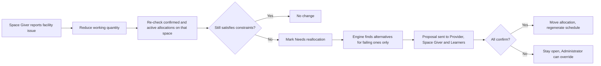
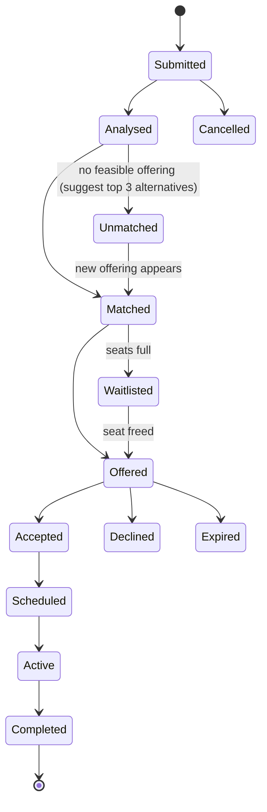
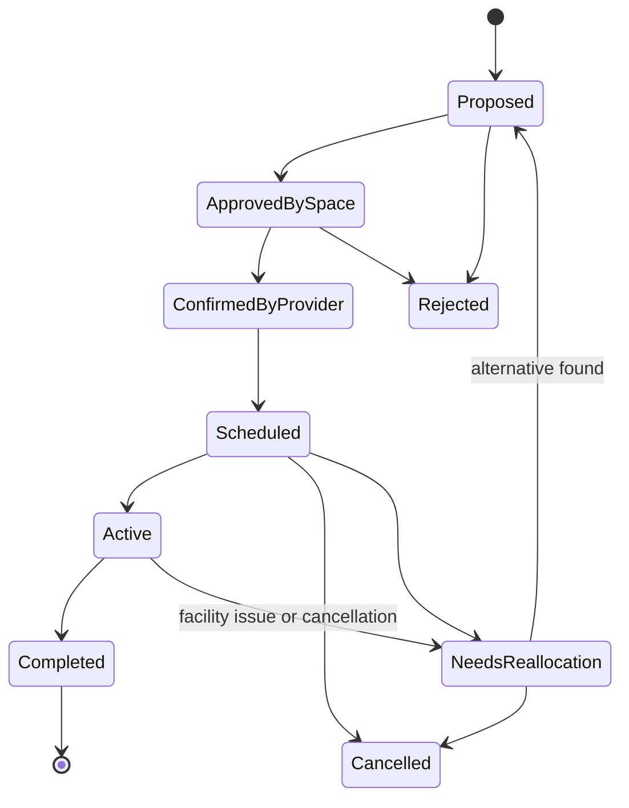
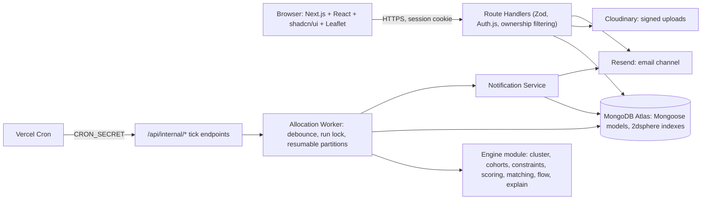

# EduSpace Allocator

> An automatic, role-based smart education infrastructure platform. It matches **idle spaces** (school rooms, college labs, community halls, NGO centres) with **course providers** and **learners**, using GIS, K-Means demand clustering and graph/flow optimisation, and explains every decision it makes.

**Status:** Built: all phases of [`PLAN.md`](./PLAN.md) are implemented and tested locally. Production setup (Atlas, Vercel, Cloudinary, Resend, GitHub) is still to do; see [Getting Started](#22-getting-started).

---

## Table of Contents

1. [Problem Statement](#1-problem-statement)
2. [Objectives and Scope](#2-objectives-and-scope)
3. [Solution Overview and Design Principles](#3-solution-overview-and-design-principles)
4. [Roles: Users and Management](#4-roles-users-and-management)
5. [Access Matrix](#5-access-matrix)
6. [Learner Privacy and Staged Visibility](#6-learner-privacy-and-staged-visibility)
7. [End-to-End Flow](#7-end-to-end-flow)
8. [Lifecycles (State Machines)](#8-lifecycles-state-machines)
9. [Complete Feature List](#9-complete-feature-list)
10. [Tech Stack](#10-tech-stack)
11. [Architecture](#11-architecture)
12. [Data Model](#12-data-model)
13. [Smart Allocation Engine](#13-smart-allocation-engine)
14. [Notification System](#14-notification-system)
15. [GIS Design](#15-gis-design)
16. [API Surface](#16-api-surface)
17. [Frontend Architecture and Navigation](#17-frontend-architecture-and-navigation)
18. [Security and Privacy](#18-security-and-privacy)
19. [Configuration: Nothing Hardcoded](#19-configuration-nothing-hardcoded)
20. [SDG Mapping and Social Impact](#20-sdg-mapping-and-social-impact)
21. [Testing Strategy](#21-testing-strategy)
22. [Getting Started](#22-getting-started)
23. [Project Structure](#23-project-structure)
24. [Risks and Future Scope](#24-risks-and-future-scope)
25. [Spec Adaptations and Additions](#25-spec-adaptations-and-additions)

---

## 1. Problem Statement

Cities hold large amounts of unused space (school rooms after hours, college labs, community halls, NGO centres). At the same time, many people cannot find an affordable place near home to learn coding, dance, music, art or take tuition, and tutors who could teach have no venue.

The two sides rarely meet because of:

| Cause | Detail |
|---|---|
| **Data silos** | Space owners, course providers and learners use separate channels |
| **Dynamic demand** | What people want to learn, and where, changes constantly |
| **Location** | A space can be free and affordable but too far from the learners who need it |
| **Manual matching** | Decisions rest on phone calls, personal contacts and spreadsheets |
| **No optimisation** | Nobody can compare hundreds of space, course and learner combinations at once |

**Core question:** which spaces should host which courses, at which times, so that the most learners are served close to home, within budget and with the right facilities, and how can that answer stay current automatically as requests change?

| Party | Pain today |
|---|---|
| Learners | Cannot find a nearby course with the right timing, duration and facilities |
| Course Providers (tutors, arts and dance teachers, institutes) | Cannot find a suitable venue and cannot see where demand is |
| Space Givers (NGOs, colleges, schools, community halls) | Spaces and hours sit idle; no safe, rule-respecting way to share them |
| Administrators | Matching by hand is slow, unfair and impossible to audit |

---

## 2. Objectives and Scope

### Objectives

1. Let Space Givers, Course Providers and Learners register their side once, in their own login.
2. Match spaces, courses and learners automatically on every relevant change, with no manual work by default.
3. Use GIS to measure real distance and show opportunities on a map.
4. Use K-Means clustering to find where demand is highest and which courses are wanted there.
5. Use bipartite and flow-based optimisation to produce the best overall allocation, not just the nearest one.
6. Explain every result: why a space or course was chosen and why others were rejected.
7. Notify every role at each important step.
8. Track social impact and map it to the Sustainable Development Goals.

### In scope

The four roles, registries, automatic Smart Allocation, offers and waitlists, scheduling, GIS, demand insights, notifications, analytics, audit logs, SDG dashboard.

### Out of scope (for now)

Online payments, video classes, native mobile apps, SMS delivery. In-app notifications come first (email is covered in [section 25](#25-spec-adaptations-and-additions)).

---

## 3. Solution Overview and Design Principles

EduSpace Allocator is a web platform with four kinds of login:

- **Space Givers** publish spaces with facilities, weekly time slots and usage policies.
- **Course Providers** publish what they teach and when.
- **Learners** say what they want to learn, where and when.
- An **event-driven Smart Allocation engine** reacts to every submission, groups demand with K-Means, filters feasible options, runs graph matching and flow optimisation, and proposes allocations that each party can confirm.

| Principle | Meaning |
|---|---|
| **Automatic by default** | The engine runs on submissions; Administrators monitor and override |
| **Nothing hardcoded** | Weights, radii, thresholds, facility types, course categories and notification templates live in the database |
| **Explainable** | Every allocation stores its score breakdown and the reasons alternatives were rejected |
| **Need-to-know privacy** | Learner details reach only the parties their request is matched to |
| **Human confirmation at key points** | Policies, offers and reallocations are confirmed by the people affected |
| **K-Means and matching stay internal** | Users see "Smart Allocation" and "Demand Insights", never algorithm names in the menu |

---

## 4. Roles: Users and Management

The spec fixes **exactly four roles**. No fifth role is needed. Three are **user-facing** (self-registered) and one is **management** (platform team).

| Role | Type | Who they are | Main purpose | How the account is created |
|---|---|---|---|---|
| **Administrator** | Management | The platform team | Full CRUD, sees every login's view, monitors and overrides Smart Allocation, owns settings | Seeded, or created by another Administrator. Never self-registered |
| **Learner** | User | Students and normal people | Request a course, accept offers, attend, give feedback | Self-registration with consent |
| **Space Giver** | User | NGOs, colleges, schools, community halls | Register spaces, facilities, slots, policies and rent; approve use where required | Self-registration |
| **Course Provider** | User | Arts, dance, music, study and tutoring providers, individual or organisation | Register courses and offerings; confirm allocations; teach | Self-registration. Tutors register here too (individual tutor or organisation) |

### Non-role actors

| Actor | Description |
|---|---|
| **Visitor (unauthenticated)** | Optional public read-only page (public impact numbers). Not a role; spec marks it as "can come later" |
| **Allocation Worker** | System actor that debounces events and runs Smart Allocation. Invoked by the scheduler, not by users |
| **Notification Service** | System actor that renders templates and delivers in-app (and optionally email) notifications |

**Golden rule:** all basic windows are visible to every login, but only the owning login can change its own data.

### Role journeys at a glance

| Role | Journey |
|---|---|
| **Learner** | Register and consent, submit request, status timeline, receive offer, accept or decline before expiry, see schedule and map, attend, rate course |
| **Space Giver** | Register, add space with facilities, weekly slots and policy, receive allocation proposals, approve (if manual), view utilisation and nearby demand, report facility issues |
| **Course Provider** | Register, add courses and requirements, create offerings (windows, batch size, duration, target area), confirm allocation, see accepted learners, teach, track attendance |
| **Administrator** | Monitor runs and KPIs, handle unmatched requests, override allocations, manage settings and strategies, review audit logs, resolve facility alerts, view SDG impact |

---

## 5. Access Matrix

| Window | Administrator | Learner | Space Giver | Course Provider |
|---|---|---|---|---|
| Dashboard | Global | Personal | Personal | Personal |
| Space Registry | Full CRUD | View public info | Edit own | View public info |
| Course Offerings | Full CRUD | View | View | Edit own |
| Learning Requests | Full CRUD | Edit own | Matched requests only | Matched requests only |
| Demand Insights | Full | Own area summary | Aggregated view | Aggregated view |
| Allocations | Full and override | Own offers | Allocations on own spaces | Allocations on own offerings |
| GIS Map | Full | Nearby offers | Own spaces and demand layer | Own offerings and demand layer |
| Analytics | Full | None | Own spaces | Own courses |
| Audit Logs | Full | None | Own activity | Own activity |
| SDG and Impact | Full | Public view | Public view | Public view |
| Notifications | All system alerts | Own | Own | Own |
| Settings and Run Monitor | Full | None | None | None |

Enforcement is **server-side** (ownership filtering in every Route Handler), never only in the UI.

---

## 6. Learner Privacy and Staged Visibility

Learners share only essential details: name, age band, contact, locality (approximate location), accessibility needs, course wanted, timings and duration. They tick a **consent** box at submission (recorded with timestamp).

| Stage | Course Provider sees | Space Giver sees |
|---|---|---|
| Before matching | Aggregated demand only: counts per area and course, demand level | Aggregated demand only |
| Allocation proposed | Cohort summary: learner count, area, timings | Headcount and timings |
| After the learner accepts | Name, age band, contact and request details of accepted learners | Roster of names for entry; **no contact details** |
| Always | The Administrator sees everything; each learner sees their own data and what was shared | |

Location privacy: other roles see learner locations only as the **locality centre**, never the exact point. Redaction happens in the DTO mapping layer.

---

## 7. End-to-End Flow

### 7.1 System swimlane (automatic flow)



### 7.2 Sequence: submission to scheduled class



### 7.3 Reallocation flow (facility issue or cancellation)



> Nothing moves silently: confirmed and active allocations change only through a facility issue, a cancellation, or an Administrator override.

### 7.4 Step table (from the spec)

| # | Actor / trigger | System does | Result |
|---|---|---|---|
| 1 | Space Giver saves space, facilities, weekly slots, policy | Validates, stores location as a geo point, publishes event | Space visible platform-wide |
| 2 | Course Provider submits an offering | Validates, publishes event | Offering ready for allocation |
| 3 | Learner submits a request | Validates, stores consent, publishes event | Request queued |
| 4 | Any event above | Worker waits a debounce window, then starts a run | Run record created |
| 5 | Engine | Clusters demand, filters candidates, matches, optimises, explains | Allocations proposed |
| 6 | Space policy | Auto-approves compliant allocations, or asks Space Giver when manual | Allocation approved |
| 7 | Course Provider | Confirms the allocation | Allocation confirmed |
| 8 | Learners | Receive offers, accept or decline within a set time; next waitlisted learner is offered declined seats | Cohort filled |
| 9 | System | Generates a conflict-free schedule | Sessions on calendars and map |
| 10 | Course runs | Attendance and feedback recorded | Impact numbers update |
| 11 | Facility issue or cancellation | Re-checks affected allocations, finds alternatives, asks affected parties to confirm | Reallocation proposal |

---

## 8. Lifecycles (State Machines)

### Learning request



### Allocation



### Enrollment

`Offered` → `Accepted` | `Declined` | `Expired`; `Waitlisted` → `Offered` when a seat frees up.

---

## 9. Complete Feature List

Feature IDs are referenced by [`PLAN.md`](./PLAN.md) for traceability.

### Identity and access
- **F-01** Four roles with role-based menu served from the backend
- **F-02** Self-registration for Learner, Space Giver, Course Provider; Administrator created by seed or another Administrator
- **F-03** Server-side ownership filtering on every endpoint
- **F-04** Personal dashboard per role; shared read-only basic windows

### Registries
- **F-05** Space Registry: facilities (type, quantity, working quantity), weekly slots (day, start, end, blocked), structured policy (allowed categories, allowed audience, rent per hour, approval mode, rules), location
- **F-06** Lookups: FacilityType (computers, projector, Wi-Fi, dance floor, mirrors, music system, accessibility), CourseCategory (with parent for similarity)
- **F-07** Course and CourseOffering: requirements (facility and minimum quantity), preferred windows, batch size, duration in weeks, target area, status
- **F-08** Learning Request: essential details, course category, max distance, facilities, preferred windows (flexible to tutor), start month, duration, consent

### Smart Allocation
- **F-09** Event-driven automatic runs with debounce; single run at a time; nightly re-optimisation of unconfirmed allocations; retries and run monitor
- **F-10** K-Means demand analysis per area with silhouette-selected k and High / Medium / Emerging labels
- **F-11** Learner cohort formation by K-Means on coordinates
- **F-12** Seven hard constraints with first-failure reason recorded
- **F-13** Weighted scoring with four strategy presets (Balanced, Accessibility first, Maximum reach, Cost efficient)
- **F-14** Space matching by maximum-weight bipartite matching
- **F-15** Learner assignment by min-cost flow with exact seat limits, waitlist with second-best option
- **F-16** Explainability: "Why this space" and "Why not the others", shown as a compatibility score (not a probability)
- **F-17** Suggestions for unmatched learners (top three with reasons; request stays open)
- **F-18** Reallocation on facility issue or cancellation
- **F-19** Evaluation per run with a greedy nearest-space baseline for comparison
- **F-20** Administrator monitor, re-run and override

### Offers and scheduling
- **F-21** Enrollments with offer expiry, accept, decline, waitlist promotion
- **F-22** Space approval modes (auto or manual)
- **F-23** Conflict-free schedule generation and conflict detection
- **F-24** Attendance records and learner feedback (rating and comment)

### Insights, GIS, notifications
- **F-25** Demand Insights (area x category: demand, seats offered, gap, level), aggregated for providers and space givers
- **F-26** Multi-area demand alert to Space Givers and Course Providers
- **F-27** One notification system for all roles with templates, bell, notification page, read / unread
- **F-28** GIS map: spaces by status, allocation lines, demand heatmap, nearby offers, unused hours, layer toggles
- **F-29** Privacy rounding of learner locations to locality centre

### Operations and governance
- **F-30** Facility issues: report, resolve, trigger reallocation
- **F-31** Analytics per role scope
- **F-32** Audit log for every create, update, delete and engine decision
- **F-33** Social Impact tracking and SDG dashboard (SDG 4, 8, 9, 10, 11, 17)
- **F-34** Settings: weights, strategies, thresholds, radius, debounce, offer expiry, alert N / M / W
- **F-35** Seed generator with configurable mix of feasible and infeasible cases
- **F-36** Suggested course types when no exact match exists (Discover Courses)

---

## 10. Tech Stack

The spec's original stack (React/Vite, ASP.NET Core, PostgreSQL with PostGIS, Python FastAPI) is replaced by the following stack.

| Component | Technology |
|---|---|
| Framework | Next.js (App Router) |
| Language | TypeScript (strict) |
| UI | React |
| Styling | Tailwind CSS |
| UI components | shadcn/ui |
| Backend APIs | Next.js Route Handlers |
| Database | MongoDB Atlas |
| Database ODM | Mongoose |
| Authentication | Auth.js (JWT session carrying role and owner claims) |
| Media storage | Cloudinary |
| Maps | Leaflet + OpenStreetMap |
| Validation | Zod |
| Email notifications | Resend |
| Deployment | Vercel |
| Version control | GitHub |

### Supporting libraries (proposed)

| Need | Library |
|---|---|
| K-Means | `ml-kmeans` (k-means++ init, seeded) plus our own StandardScaler and silhouette |
| Matching | Own Hungarian / Kuhn-Munkres implementation for bipartite max weight |
| Min-cost flow | Own successive-shortest-path implementation (small graphs after partitioning) |
| Heatmap | `react-leaflet` with circle markers per area (or `leaflet.heat`) |
| Charts | Recharts |
| Data fetching and polling | TanStack Query |
| Forms | React Hook Form with `@hookform/resolvers/zod` |
| Password hashing | `bcryptjs` |
| Tests | Vitest, Playwright, `mongodb-memory-server` |
| CI | GitHub Actions |

### Mapping from the spec's stack

| Spec | This project | Notes |
|---|---|---|
| React (Vite) | Next.js App Router + React | Server components for read-heavy pages |
| ASP.NET Core Web API | Route Handlers | One `withAuth` wrapper for roles and ownership |
| EF Core, Npgsql | Mongoose | Embedded sub-documents replace many join tables |
| ASP.NET Identity + JWT | Auth.js, JWT strategy | `role` and `ownerRefId` in token |
| PostgreSQL + PostGIS | MongoDB `2dsphere` indexes | `$geoNear`, `$geoWithin`, `$centerSphere` |
| Python FastAPI engine | TypeScript engine module | Pure functions, no I/O. Hidden behind an `EngineClient` interface so a Python service can be swapped in later if needed |
| BackgroundService + Channel | `DomainEvent` outbox + scheduled tick endpoint | Vercel has no long-lived workers |
| SignalR | Polling (TanStack Query), SSE later | Serverless functions do not hold WebSockets |
| xUnit, pytest | Vitest, Playwright | |

---

## 11. Architecture



**Layer rules**

| Layer | Responsibility |
|---|---|
| UI (Next.js) | Role-aware shell, Leaflet map, charts, polling for live notifications |
| Route Handlers | Authentication, CRUD, validation, ownership filtering, DTO redaction, event outbox |
| Worker | Debounce, single-run lock, snapshot read, call engine, save in one transaction |
| Engine (`src/engine`) | Pure, deterministic functions. **Never** imports Mongoose, Next.js or React |
| MongoDB | All data, geo indexes, distance queries |

**Rule:** the browser never calls the engine. Only the worker invokes it, server-side.

**Request path:** user submits form, handler validates and saves, event enters the outbox, worker starts a run, engine returns results, results are saved in one transaction, notification service informs affected people.

**Worker design on Vercel**
- `DomainEvent` documents are the queue. Vercel Cron calls `/api/internal/allocation/tick`, which starts a run only when unprocessed events exist and the newest is older than the debounce window.
- A lock document with an expiry guarantees one run at a time.
- Runs are split into area partitions and are resumable, so a large run can span several function invocations within `maxDuration` limits.
- Nightly cron re-optimises unconfirmed allocations; another job expires offers and promotes the waitlist.
- Cron frequency depends on the Vercel plan. Verify current limits before choosing the tick interval.

---

## 12. Data Model

Mongoose collections. Sub-documents are embedded where the spec uses join tables that are always read with their parent.

| Collection | Key fields | Notes |
|---|---|---|
| `users` | email, passwordHash, role, ownerRefId, status | Roles: Administrator, Learner, SpaceGiver, CourseProvider |
| `learnerProfiles` | userId, name, ageBand, contact, areaId, accessibilityNeeds | Target of `ownerRefId` for learners |
| `partners` | type (SpaceGiverOrg, ProviderOrg, IndividualTutor), name, logoUrl | Shown as "provider organisation" in UI |
| `facilityTypes` | name, unit | Lookup |
| `courseCategories` | name, parentId | Lookup, parent drives similarity |
| `spaces` | ownerUserId, name, location (GeoJSON), areaId, isActive, photos, **facilities[]** (facilityTypeId, quantity, workingQuantity), **slots[]** (dayOfWeek, startTime, endTime, isBlocked), **policy** (allowedCategories, allowedAudience, rentPerHour, approvalMode, rules) | `2dsphere` on `location` |
| `areas` (Community) | name, center (GeoJSON), population, studentCount, literacyRate, incomeScore, incomeGroup, demandLevel, clusterId | `2dsphere` on `center` |
| `studentDemand` | areaId, categoryId, baseline demand | Ported from foundation |
| `courses` | providerId, title, categoryId, **requirements[]** (facilityTypeId, minQuantity) | |
| `courseOfferings` | courseId, providerId, batchSize, durationWeeks, targetAreaId, status, **windows[]** (dayOfWeek, startTime, endTime), budget | |
| `learningRequests` | learnerUserId, categoryId, areaId, location (GeoJSON, private), maxDistanceKm, startMonth, durationMonths, consentShared, consentAt, status, **windows[]**, requiredFacilities, budget | `2dsphere` on `location` |
| `allocationRuns` | trigger, startedAt, finishedAt, status, metrics, baselineMetrics, partitionState | |
| `allocations` | runId, offeringId, spaceId, slot, scoreBreakdown[], rejectedAlternatives[], strategy, status | |
| `enrollments` | requestId, allocationId, status (Offered, Accepted, Declined, Waitlisted, Expired), offerExpiresAt, secondBest | |
| `schedules` | allocationId, spaceId, offeringId, date, startTime, endTime, status | Conflict detection runs on write |
| `attendanceRecords` | enrollmentId, sessionDate, present | |
| `feedback` | enrollmentId, rating, comment | |
| `demandInsights` | areaId, categoryId, level, demand, seatsOffered, gap, computedAt | |
| `facilityIssues` | spaceId, facilityTypeId, affectedQuantity, status | Triggers reallocation |
| `notifications` | userId, type, message, relatedType, relatedId, isRead, createdAt | |
| `notificationTemplates` | type, role, titleTemplate, bodyTemplate | Editable without redeploy |
| `systemSettings` | key, value, description | Weights, strategies, thresholds |
| `domainEvents` | type, refId, createdAt, processedAt | Outbox for the worker |
| `auditLogs` | actorId, action, entity, entityId, diff, createdAt | Includes engine decisions |
| `socialImpacts` | period, metrics (learners served, hours, idle hours used, areas reached, avg distance) | Feeds SDG dashboard |

**Index highlights:** `2dsphere` on `spaces.location`, `areas.center`, `learningRequests.location`; compound indexes on `(status, categoryId, areaId)` for requests, `(spaceId, dayOfWeek)` for slots, and `(processedAt, createdAt)` for the outbox.

**Relationships:** a Space has many facilities, slots and one policy; a Course has requirements; an Offering belongs to a Course and a provider and has preferred windows; a Learning Request belongs to a Learner and an Area; an Allocation joins one Offering to one Space slot; Enrollments join Learning Requests to Allocations; Schedules and Attendance hang off Allocations.

---

## 13. Smart Allocation Engine

### 13.1 Triggers and orchestration

1. Saving a space, slot, policy, offering, request or facility issue writes a `DomainEvent`.
2. The worker collects events for a short **debounce window** (setting, e.g. 30 s), so a burst of submissions causes one run.
3. It creates an `AllocationRun`, reads a snapshot of open data, calls the engine, and saves results in **one transaction**. Only one run executes at a time.
4. A **nightly run** re-optimises everything not yet confirmed. Confirmed and active allocations change only through a facility issue, a cancellation, or an Administrator override.
5. Failed runs are retried and shown in the Administrator run monitor.

### 13.2 Pipeline

| Step | What happens | Technique |
|---|---|---|
| 1 Prepare | Load open spaces, slots, offerings, requests, areas; compute distances | `$geoNear` prefilter, exact distance |
| 2 Demand analysis | Cluster areas into demand levels; compute demand gap per area and category | K-Means, StandardScaler |
| 3 Cohorts | Group nearby learners wanting the same category into batches that fit offerings | K-Means on coordinates |
| 4 Candidates | Keep only space-slot and offering pairs passing every hard constraint | Rule filters |
| 5 Scoring | Score each feasible pair 0 to 1 using configurable weights | Weighted sum |
| 6 Space matching | Assign each offering to the best slots so total score is maximal | Max-weight bipartite matching |
| 7 Learner assignment | Assign learners to offerings within seat limits; overflow becomes waitlist | Min-cost flow |
| 8 Explain | Store the score breakdown and reasons alternatives lost | Structured result |
| 9 Publish | Save allocations, enrollments, insights; trigger notifications | Single DB transaction |

### 13.3 K-Means: preprocessing, encoding, training

- **Features per area:** Population, StudentCount, LiteracyRate, IncomeScore, RequestDensity (open requests per 1,000 students), UnmetDemand (demand minus seats offered).
- **Encoding:** IncomeGroup is ordinal-encoded (Low 0, Medium 1, High 2) because the categories have a real order.
- **Scaling:** StandardScaler on every feature so population does not dominate distance.
- **Training:** fixed seed 42, 10 initialisations (keep the lowest inertia). k chosen from 2 to 6 by best **silhouette score**, fallback 3. Unsupervised: no labels, no train/test split, refitted on every run.
- **Labelling:** clusters are ranked by a combined demand index of their centroid and named **High, Medium and Emerging Demand**, so labels stay correct whatever cluster numbers come back.
- **Cohorts:** learners wanting the same category are clustered on projected coordinates, with k = number of requests / target batch size, so each cluster is a realistic class.

### 13.4 Hard constraints

A pair is feasible only if **all** pass. The first failure is recorded as the reason.

1. Space is active and the slot is not blocked.
2. Slot covers the required session times and does not clash with existing bookings.
3. Usable seats are at least the batch size.
4. Every required facility is present in sufficient **working** quantity.
5. Space policy allows the course category and audience.
6. Distance is within the learner's maximum and the global maximum radius.
7. Rent fits the budget set for the offering or request.

### 13.5 Scoring

Each sub-score is between 0 and 1.

| Sub-score | Formula |
|---|---|
| Distance | 1 − distance / maxRadius |
| Time fit | overlapping minutes / required minutes |
| Facility fit | required facilities met, small bonus for useful extras |
| Capacity fit | min(1, batchSize / usableSeats) |
| Cost fit | max(0, 1 − rent / budget) |
| Demand priority | the area's demand level and gap |
| Utilisation | 1 − current weekly utilisation (favours under-used spaces) |

Weights live in `systemSettings`. An Administrator picks the active strategy.

| Strategy | Distance | Time | Facility | Capacity | Cost | Demand | Utilisation |
|---|---|---|---|---|---|---|---|
| **Balanced (default)** | 0.25 | 0.20 | 0.15 | 0.15 | 0.10 | 0.10 | 0.05 |
| Accessibility first | 0.40 | 0.20 | 0.10 | 0.10 | 0.05 | 0.10 | 0.05 |
| Maximum reach | 0.15 | 0.15 | 0.10 | 0.25 | 0.05 | 0.25 | 0.05 |
| Cost efficient | 0.15 | 0.15 | 0.10 | 0.15 | 0.35 | 0.05 | 0.05 |

### 13.6 Matching and optimisation

- **Space matching:** left nodes are offerings, right nodes are space slots, edges exist only for feasible pairs scoring above a minimum threshold. Maximum-weight matching returns the globally best assignment, not a greedy nearest-first one.
- **Learner assignment:** min-cost flow. Source to learner capacity 1; learner to offering cost proportional to (1 − score), scaled to integers; offering to sink capacity equal to its seats. Seat limits are respected exactly. Leftover learners become a waitlist with a second-best offering recorded.
- **Scaling:** areas and demand clusters split the problem into smaller graphs, and the geo prefilter removes distant pairs before any graph is built.
- **Optimisation score for reporting:** weighted blend of match score, capacity utilisation, cost efficiency and student reach.

### 13.7 Explainability

Every allocation stores one entry per criterion: criterion name, whether it passed, and a short detail (e.g. "80 working computers against 60 required"). The closest rejected alternatives are stored with their first failed constraint. The UI shows **Why this space** and **Why not the others**, and calls the number a **compatibility score**, not a probability.

### 13.8 Suggestions for unmatched learners

When no feasible offering exists, alternatives are ranked by: 0.4 distance, 0.3 time fit, 0.2 category similarity (same parent category), 0.1 popularity within the learner's demand cluster. The top three are shown with reasons and the request stays open so a new offering can still serve it.

### 13.9 Reallocation

A facility issue reduces working quantities. The engine re-checks confirmed and active allocations on that space, finds alternatives only for those that now fail, marks them **Needs reallocation**, and sends proposals. Provider, Space Giver and learners confirm; nothing moves silently.

### 13.10 Evaluation

Each run stores coverage rate (requests served), average distance, seat utilisation, space utilisation hours, average score, waitlist rate and run time. The same data is also allocated by a **greedy nearest-space baseline** so the report can show the improvement from matching and optimisation.

---

## 14. Notification System

Notifications are stored in the `notifications` collection, rendered from `notificationTemplates`, and surfaced live through polling. Every role has a bell icon, a notification page and read / unread state.

| Event | Recipients | Example |
|---|---|---|
| Request received | Learner | Your Python request was received and is being matched |
| Allocation proposed | Space Giver, Course Provider | Python Basics proposed at Sunrise Plaza, Mon and Wed 6 to 8 PM |
| Space approval needed or given | Space Giver, Course Provider | Approval required, or approved under your policy |
| Offer sent, expiring, accepted, declined | Learner, Course Provider | Your seat is held until Friday 6 PM |
| Schedule created, changed or clashing | Everyone involved | Class moved to Tuesday because of a clash |
| Multi-area demand alert | Space Givers with a suitable free slot, Course Providers with a matching skill | 4 areas near Kothrud have 85 open requests for Python and you have a free Mon to Wed evening slot with 60 computers |
| Facility issue reported | Administrator, affected providers and learners | 20 computers are down; alternatives are being found |
| Reallocation proposal | Affected parties | An alternative space 1.7 km away is available |
| Course completed | Learners | Please rate your course |
| Engine run failed | Administrator | Run 128 failed; retry scheduled |

**Multi-area alert rule:** fires when at least **N** different areas each have at least **M** open requests for the same course category within **W** days and no confirmed offering covers them. N, M and W are settings. An alert is not repeated until demand changes.

---

## 15. GIS Design

- **Storage:** GeoJSON `Point` (`[lng, lat]`) with `2dsphere` indexes on spaces, areas and requests. `$geoNear` / `$geoWithin` for the radius prefilter and exact distance.
- **Layers:** spaces coloured by status, allocation lines from space to learner area, demand heatmap by area, nearby offers for a learner, unused hours for a Space Giver.
- **Client:** Leaflet with OpenStreetMap tiles (loaded client-side only) and layer toggles for *available only*, *course category* and *demand level*.
- **Privacy:** other roles see learner locations only as the locality centre, never the exact point.

---

## 16. API Surface

All handlers live under `src/app/api` and are wrapped by `withAuth({ roles })` plus Zod validation.

| Area | Endpoints | Access |
|---|---|---|
| Auth and Me | `POST /api/auth/register`, Auth.js routes, `GET /api/me`, `GET /api/me/menu` | Public and authenticated |
| Spaces, slots, policies, facilities | CRUD `/api/spaces`, `/api/spaces/:id` (slots, policy, facilities embedded) | Space Giver owns; all read public fields |
| Offerings and courses | CRUD `/api/courses`, `/api/offerings`; catalogue read | Course Provider owns |
| Learning requests | `POST /api/requests`, `GET /api/requests/mine`, `GET /api/requests/matched` | Learner owns; providers see matched only, redacted by stage |
| Enrollments | `POST /api/enrollments/:id/accept`, `.../decline`, `GET /api/enrollments/mine` | Learner |
| Allocations | list, `POST .../approve`, `POST .../confirm`, `POST .../override` | Role-scoped; override is Administrator only |
| Allocation runs | `GET /api/runs`, `POST /api/runs` (trigger), `GET /api/runs/:id` | Administrator |
| Demand insights | `GET /api/demand-insights` (by area and category) | All roles, aggregated |
| Recommendations | `GET /api/recommendations?requestId=` | Learner, Administrator |
| Notifications | list, `POST .../read`, `GET .../unread-count` | Owner |
| Facility issues | report, resolve | Space Giver, Administrator |
| Analytics, audit, impact, SDG | read | Role-scoped |
| Settings | read, update weights and thresholds | Administrator |
| Uploads | `POST /api/uploads/sign` (Cloudinary signature) | Authenticated |
| Internal (cron) | `/api/internal/allocation/tick`, `/api/internal/nightly`, `/api/internal/offers/expire` | `CRON_SECRET` only |

---

## 17. Frontend Architecture and Navigation

**Role-aware shell:** after login the app loads the menu and permissions from `GET /api/me/menu`, guards routes by role (middleware plus server checks) and shows the personal dashboard. The sidebar for each role is served from the backend, so adding a page needs no frontend role logic.

| Role | Sidebar | Dashboard widgets |
|---|---|---|
| **Administrator** | Dashboard, Space Registry, Learning Requests, Course Offerings, Smart Allocation, Allocation Results, Demand Insights, GIS Mapping, Analytics, Audit Logs, Social Impact, SDG Dashboard, Settings (plus Users, see section 25) | Global KPIs, run monitor, unmatched requests, facility alerts, demand heatmap, utilisation, impact |
| **Learner** | Dashboard, My Requests, Offers, Discover Courses, GIS Map, Notifications | Request status timeline, pending offers with accept / decline, recommended courses, nearby map |
| **Space Giver** | Dashboard, My Spaces, Slots and Policies, Allocations, Demand Insights, GIS Map, Facility Issues, Notifications | Utilisation, upcoming sessions, pending approvals, unused hours, nearby demand, issues |
| **Course Provider** | Dashboard, My Courses, Offerings, Assigned Spaces, Learners, Demand Insights, GIS Map, Notifications | Offering status, assigned space and slot, accepted learners, high-demand areas and courses, attendance |

**Shared components:** data table (search, filter, sort, pagination), status badge, KPI tile, explain panel, notification bell, map layer toggle, validated form.

**State and services:** one fetch client, one service module per domain, TanStack Query for caching and polling, and loading, empty and error states on every page.

**Style:** follows the EduSpace design system (https://claude.ai/artifact/58sQU8fyC1kGAdBL2o9xmQ): warm paper rail, white working panels, one orange accent, Geist and Geist Mono, light and dark themes, expressed as Tailwind theme tokens and shadcn/ui variables.

---

## 18. Security and Privacy

- Auth.js JWT carries `role` and `ownerRefId`; policy-based authorisation on every Route Handler.
- Ownership filtering on the server, never only in the interface.
- Learner data redacted by stage in DTO mapping; consent recorded with timestamp.
- Every create, update, delete and engine decision written to the audit log.
- Zod validation on all inputs, consistent error responses, HTTPS (Vercel), secrets only in environment variables.
- Internal cron endpoints require `CRON_SECRET`; Cloudinary uploads use server-signed parameters.
- Privacy must be **tested, not assumed** (see authorisation tests below).

---

## 19. Configuration: Nothing Hardcoded

| Item | Where it lives |
|---|---|
| Scoring weights, strategies, thresholds, radius, debounce, offer expiry | `systemSettings` |
| Facility types and course requirements | `facilityTypes`, `courses.requirements` |
| Course categories and similarity | `courseCategories` |
| Notification text | `notificationTemplates` |
| Sidebar and permissions per role | `GET /api/me/menu` |
| Demand levels and clusters | Computed on every run, stored in `demandInsights` |
| Demo data | Seed generator with a configurable mix of feasible and infeasible cases |

---

## 20. SDG Mapping and Social Impact

| Goal | Indicator |
|---|---|
| SDG 4 Quality Education | Learners served, learning hours delivered |
| SDG 8 Decent Work and Economic Growth | Course providers and tutors with a venue, sessions scheduled |
| SDG 9 Industry, Innovation and Infrastructure | Idle spaces and hours put to use |
| SDG 10 Reduced Inequalities | Areas reached, high-demand areas served |
| SDG 11 Sustainable Cities and Communities | Average travel distance reduced, space utilisation |
| SDG 17 Partnerships for the Goals | Active Space Givers, Course Providers and NGOs |

**SIPOC**

| Suppliers | Inputs | Process | Outputs | Customers |
|---|---|---|---|---|
| Space Givers, municipal property data, NGOs | Spaces, slots, facilities, policies, learner requests, demographics | K-Means clustering, graph matching, flow optimisation | Allocations, offers, schedules, insights | Education departments, NGOs, providers, learners |

**ETVX.** Entry: cleaned demographic and space data. Task: cluster demand, match and optimise. Verification: coverage, distance and utilisation against the greedy baseline. Exit: an interactive interface showing the recommended allocations.

---

## 21. Testing Strategy

| Level | Coverage |
|---|---|
| Unit (Vitest) | Hard constraints, scoring, K-Means labelling, matching, flow capacity limits, privacy redaction |
| Integration | Event to run to notifications; offer accept and decline with waitlist promotion; facility issue to reallocation (`mongodb-memory-server`) |
| Authorization | Every role blocked from editing another owner's data and from seeing redacted learner fields |
| End-to-end (Playwright) | Weekend coding classes in South Pune, from request to scheduled class |
| Performance | A run on about 500 spaces and 2,000 requests finishes within the target time |

---

## 22. Getting Started

New to the project? Follow the step-by-step guide in [`docs/SETUP.md`](./docs/SETUP.md). For how the system works for each role, read [`docs/SYSTEM_GUIDE.md`](./docs/SYSTEM_GUIDE.md).

**Prerequisites:** Node.js 22.12+ (24 recommended) and MongoDB 8. Locally a single-node replica set is best, because results are published in a transaction; a standalone server also works (publish then runs without a transaction but stays idempotent). Cloudinary and Resend are optional: photo uploads and email stay off until configured.

```bash
npm install
cp env.example .env.local        # fill in the values below
npm run seed                     # lookups, Pune areas, settings, templates, admin, demo data
npm run dev                      # http://localhost:3000
```

Smart Allocation runs from the worker tick. Locally, trigger it by hand: sign in as the Administrator and press **Run Allocation**, or call the tick:

```bash
curl -H "Authorization: Bearer $CRON_SECRET" http://localhost:3000/api/internal/allocation/tick
```

Demo logins after `npm run seed` (password `Demo-Pass-2026` unless `SEED_DEMO_PASSWORD` is set): `learner@eduspace.local`, `spaces@eduspace.local`, `provider@eduspace.local`, plus the Administrator from `ADMIN_SEED_EMAIL` / `ADMIN_SEED_PASSWORD`. Seed profiles and flags: [`docs/seed.md`](./docs/seed.md).

### Environment variables

| Variable | Required | Purpose |
|---|---|---|
| `MONGODB_URI` | Yes | MongoDB connection string (Atlas in production) |
| `AUTH_SECRET` | Yes | Auth.js signing secret, 32+ random characters |
| `CRON_SECRET` | Yes | Protects `/api/internal/*`; Vercel Cron sends it as a Bearer token |
| `AUTH_URL`, `AUTH_TRUST_HOST` | Production | Public base URL; trust the Vercel host |
| `ADMIN_SEED_EMAIL`, `ADMIN_SEED_PASSWORD` | For seeding | First Administrator (created once, never overwritten) |
| `CLOUDINARY_CLOUD_NAME`, `CLOUDINARY_API_KEY`, `CLOUDINARY_API_SECRET` | Optional | Signed photo uploads |
| `RESEND_API_KEY`, `EMAIL_FROM` | Optional | Email copies of notifications (also switch on in Settings) |
| `SEED_DEMO_PASSWORD`, `E2E_MONGODB_URI` | Optional | Demo account password; Playwright database |

The app refuses to start when a required variable is missing and names it.

### Scripts

| Script | Purpose |
|---|---|
| `npm run dev` / `build` / `start` | Next.js lifecycle |
| `npm run lint` / `typecheck` | Static checks |
| `npm test` | Vitest unit and integration tests on an in-memory MongoDB replica set |
| `npm run test:e2e` | Playwright: weekend coding classes in South Pune, request to scheduled class |
| `npm run seed` / `seed:reset` | Seed generator: `--profile=minimal\|demo\|e2e\|bench`, `--seed=n`, `--reset` |
| `npm run engine:bench` | Engine benchmark (500 spaces, 2,000 requests); writes `bench-results/latest.json` |

API reference for each module: [`docs/api/registry.md`](./docs/api/registry.md), [`docs/api/allocation.md`](./docs/api/allocation.md), [`docs/api/insights.md`](./docs/api/insights.md). UI component catalogue: [`docs/ui.md`](./docs/ui.md).

---

## 23. Project Structure

```
eduspace-allocator/
├─ README.md
├─ PLAN.md
├─ src/
│  ├─ app/
│  │  ├─ (public)/                 # landing, public impact page
│  │  ├─ (auth)/                   # login, register
│  │  ├─ (app)/                    # role-aware shell
│  │  │  ├─ dashboard/ spaces/ offerings/ requests/ offers/
│  │  │  ├─ discover/ allocations/ demand-insights/ map/
│  │  │  ├─ analytics/ notifications/ audit-logs/
│  │  │  ├─ impact/ sdg/ settings/ runs/ facility-issues/ users/
│  │  └─ api/                      # Route Handlers (see section 16)
│  ├─ components/                  # shadcn/ui + shared components
│  ├─ engine/                      # pure TypeScript, no I/O
│  │  ├─ kmeans/ constraints/ scoring/ matching/ flow/
│  │  ├─ explain/ suggest/ reallocate/ evaluate/ pipeline.ts
│  ├─ server/
│  │  ├─ models/                   # Mongoose schemas
│  │  ├─ services/                 # business logic per domain
│  │  ├─ worker/                   # outbox, lock, run orchestration
│  │  ├─ notifications/            # templates, delivery (in-app, Resend)
│  │  ├─ auth/                     # withAuth, ownership scoping
│  │  └─ dto/                      # stage-based redaction mappers
│  ├─ lib/                         # db connection, cloudinary, utils
│  └─ schemas/                     # Zod schemas shared by client and server
├─ scripts/                        # seed, bench
├─ tests/                          # unit, integration, e2e
└─ .github/workflows/ci.yml
```

---

## 24. Risks and Future Scope

**Risks and limitations**

- **Cold start:** with few providers most learners are unmatched, so suggestions, waitlists and a realistic seed set matter.
- **Weights need tuning** on real data; presets and settings make this safe.
- **Privacy:** staged visibility and consent must be tested, not assumed.
- **Learners are individuals:** cohorts are estimates until learners accept offers.
- **Serverless limits:** long runs must be partitioned and resumable (see [section 11](#11-architecture)).

**Future scope:** online payments, SMS, a mobile app, a what-if simulator, multi-city support, learned demand forecasting once real history exists, a public visitor page.

---

## 25. Spec Adaptations and Additions

Because the chosen stack differs from the spec, and the spec leaves a few gaps, these decisions are recorded here. Each can be revisited.

**Adaptations (forced by the stack)**
1. Python engine becomes a TypeScript module. K-Means uses `ml-kmeans`; matching and flow are own implementations. Output should be validated against a small Python reference (scikit-learn, NetworkX) during testing.
2. SignalR becomes polling; SSE is a later upgrade.
3. BackgroundService becomes an outbox plus scheduled tick.
4. PostGIS becomes MongoDB geospatial queries.
5. "Existing foundation" in the spec is treated as a greenfield port of the same entities.

**Additions (not in the spec, marked so they can be dropped)**
1. **Email via Resend** is included as a delivery channel because it is in the stack. The spec lists email as out of scope, so it ships after in-app notifications and is behind a feature flag and per-user preference.
2. **Users page for Administrators** (create Administrators, suspend accounts). Implied by "full CRUD" but not in the spec's sidebar.
3. **Optional admin approval of new Space Giver / Course Provider accounts**, controlled by a setting, default off.
4. **Offering status values** (Draft, Open, Allocated, Active, Completed, Cancelled), since the spec lists a `Status` field without values.
5. **Cloudinary usage:** space photos, provider logos, course covers, facility issue evidence.
6. **Password reset and email verification** via Auth.js and Resend. *Not built yet:* it needs a verified Resend domain first.

**Implementation decisions (made while building; each can be revisited)**
1. **One weekly session per offering.** An allocation books one weekly session (`sessionMinutes` long) in one space slot. Offerings that need two sessions a week are modelled as two offerings for now.
2. **Seat capacity and audience are explicit.** Spaces have `seatCapacity` (constraint 3) and offerings have an `audience` matched against the space policy and the learner's age band (constraint 5). Rent fits the offering's `maxRentPerHour`; the learner's `budgetPerMonth` is checked against the offering's `feePerMonth`.
3. **Held seats.** Enrollments have an internal `Proposed` state: the seat is held while the space approves and the provider confirms, and becomes `Offered` (with expiry) on confirmation.
4. **Re-runs replace only proposals.** Each run re-optimises open offerings and `Proposed` allocations (`Superseded` when replaced; unchanged proposals are kept so nobody is re-notified). Approved, confirmed, scheduled and active allocations change only through a facility issue, a cancellation or an Administrator override. A space's rejected pairing is not proposed again.
5. **Conflict-free by construction.** Each free part of a space slot hosts at most one new allocation per run, so a run can never double-book a space. Schedule clashes on write are flagged (status `Moved`, notification) rather than double-booked.
6. **Resumable runs by phase, not by area.** Runs record their phases (snapshot → engine → publish → notify). Snapshot and engine only read, so a run that dies before publish leaves nothing and is retried; publish is one transaction, so a run that dies after it resumes at notify. The engine handles 500 spaces and 2,000 requests in under a second, so area partitioning has not been needed.
7. **Reallocation.** A facility issue re-checks booked allocations on that space; only failing ones are marked `NeedsReallocation` (an approved-but-unconfirmed one is cancelled and re-planned). The replacement goes through the normal approve and confirm steps; learners are notified and keep the right to decline. Resolving the issue restores allocations that fit again.
8. **Optimisation goal.** Space matching maximises the total compatibility score, as section 13.6 specifies. On the demo data it beats the greedy baseline on coverage, score and distance; on the large synthetic benchmark it wins on score but seats slightly fewer learners. A reach term can be added to the matching weight if coverage should lead.
9. **Demand clustering** uses an own seeded k-means++ implementation instead of `ml-kmeans`, so results are reproducible run to run.
10. **Feedback is anonymous to providers**; Administrators and the learner themself see the name.
